# ambilight-hue-sync

Philips TV'nin kendi Ambilight renklerini, Hue Entertainment API üzerinden Philips Hue lambalarına gerçek zamanlı aktarır. Hue Play HDMI Sync Box, HDMI yakalama kartı ya da ekrana bakan bir kamera gerekmez.

Her zaman açık duran bir Linux cihazında küçük bir Python servisi olarak çalışır (Raspberry Pi 5 üzerinde test edildi) ve oturma odasındaki beş Hue lambasını her akşam TV ile birlikte sürüyor.

İngilizce ana metin: [README.md](README.md).

## Neden

Philips, Hue lambalarının görüntüyü takip etmesi için iki yol sunuyor: yalnızca bazı modellerde olan Ambilight+Hue özelliği ve kaynaklarla TV arasına giren HDMI Sync Box. Benim TV'mde (Titan OS çalışan 65PUS8209) üç taraflı Ambilight var ama Ambilight+Hue yok. Apple TV ve PS5 bağlıyken Sync Box hem ek maliyet hem fazladan bir HDMI halkası hem de HDR/VRR aktarımı konusunda soru işareti demek.

Zor kısmı TV zaten yapıyor. Ambilight motoru ekrandaki her şeyi, hangi HDMI girişinden ya da uygulamadan gelirse gelsin, analiz ediyor ve sonucu yerel JointSpace API üzerinden kenar piksel renkleri olarak sunuyor. Bu proje o veriyi okuyup Hue'ya iletiyor.

## Nasıl çalışır

```mermaid
flowchart LR
    S[Apple TV / PS5 / uygulamalar] -->|HDMI| TV[Philips TV<br>Ambilight motoru]
    TV -->|HTTPS + digest auth<br>/6/ambilight/processed<br>0.15 sn'de bir| R[TV okuyucu thread]
    R -->|lamba başına baskın ton<br>CIE xy + parlaklık| T[(hedefler)]
    T --> L[25 Hz akış döngüsü<br>üstel yumuşatma]
    L -->|HueStream v2 paketleri<br>DTLS 1.2 PSK, UDP 2100| B[Hue Bridge]
    B --> H[Entertainment alanındaki<br>Hue lambaları]
```



1. Bir okuyucu thread, uzun ömürlü tek bir HTTPS oturumuyla `https://<tv>:1926/6/ambilight/processed` adresini sorgular. Yanıt; sol, üst ve sağ kenardaki her Ambilight bölgesinin RGB değerini içerir.
2. Her lamba bir kenarın bir dilimine ("sağ kenar, alt yarı" gibi) ya da tüm kareye bağlanır. Servis o dilim için baskın tonu seçer, CIE xy'ye çevirir ve bir parlaklık hesaplar.
3. Akış döngüsü 25 Hz'de çalışır, her lambayı son hedefine doğru yumuşakça yaklaştırır ve tüm lambaları tek bir UDP paketiyle köprüye gönderir.
4. TV yanıt vermeyi bırakınca akışı bitirir ve her lambayı akış başlamadan önceki haline geri getirir.

## Mühendislik notları

Asıl hata ayıklama gerektiren kısımlar bunlar; kodun bu şekilde yazılmasının nedeni de bunlar.

### TV oturumunu her zaman yeniden kullan

İlk sürüm her istekte yeni bir HTTPS bağlantısı açıyordu. Bu TV'de bu, her 150 ms'de bir TLS el sıkışması artı bir HTTP digest sorgusu demek. Bir süre sonra JointSpace sunucusu pes etti: tüm uç noktalar 404 ya da 403 döndü ve ancak soğuk yeniden başlatma (TV'nin fişini çekmek) düzeltti. Keep alive ile tek bir `requests.Session` kullanmaya geçmek sorunu tamamen çözdü. Tekrar kullanılan oturumla TV yaklaşık 70 ila 90 ms'de yanıt veriyor ve günlerce sorunsuz çalıştı. Herhangi bir hatadan sonra okuyucu, zorlanan API'yi yormamak için bir dakika boyunca daha yavaş 0.4 sn aralığa geçer.

### Yavaş örnekle, hızlı akıt

TV'nin işlenmiş verisi yaklaşık 100 ms'den daha sık güncellenmiyor; daha hızlı sorgulamak sadece aynı kareyi döndürüyor. Hue lambaları ise 25 Hz'de sürüldüğünde çok daha akıcı görünüyor. Bu yüzden ikisi ayrı çalışıyor: okuyucu hedefleri yaklaşık 7 Hz'de güncelliyor, akış döngüsü onlara 25 Hz'de yaklaşıyor. Girdi kaba olsa da sonuç akıcı görünüyor.

### Ortalama değil, baskın ton

Denizin üzerinde turuncu bir gün batımı gösteren bir kenarın piksel ortalaması mor çıkar; ekranda olmayan bir renk. Bunun yerine her piksel 12 dilimli bir ton histogramına oy verir. Oy ağırlığı parlaklık çarpı doygunluğun karesidir, böylece canlı pikseller soluk olanlardan daha çok sayılır. Histogram komşularıyla yumuşatılır, en güçlü dilim kazanır ve yalnızca ona 45 derece yakın pikseller ortalanır. Neredeyse gri sahnelerde düz ortalamaya dönülür; karanlık sahnelerde ise ton çoğunlukla gürültü olduğu için renk kademeli olarak beyaza çekilir.

### Ayrı yükselme ve düşme ile yumuşatma

Her lamba üç zaman sabitli üstel yumuşatma kullanır: parlaklık artışı için bir, daha yavaş olan azalma için bir ve renk için bir. Patlamalar anında hissedilir, kararmalar sakin görünür; uzun bir şerit ışığa küçük bir lambadan daha yavaş sabitler verilebilir. İki küçük kural çirkin geçişleri engeller: karanlık eşiğinin altında lamba gerçekten kapanır, siyahtan dönen lamba ise beyazdan geçerek değil doğrudan yeni renge atlar.

### Durumu kaydet ve geri yükle

Entertainment akışı lambaları devralır; akış bitince lambalar son gönderilen renkte kalırdı. Servis her akış başlamadan önce her lambanın açık/kapalı durumunu, parlaklığını ve renk sıcaklığını ya da xy rengini küçük bir JSON dosyasına kaydeder; TV kapanınca ya da servis durunca bunları geri yazar. Önceki çalışma akışın ortasında kapandıysa (lambalar hâlâ `mode: streaming` diyorsa), eski kayıt korunur; çünkü o anki durum sizin ayarınız değil, akışın rengidir.

### openssl ile DTLS

Hue Entertainment API, önceden paylaşılmış anahtarlı DTLS 1.2 istiyor ve Python standart kütüphanesinde bu yok. Yerel bir DTLS bağlantı kütüphanesi eklemek yerine servis `openssl s_client -dtls1_2 -psk ...` komutunu alt süreç olarak başlatıp paketleri stdin'e yazıyor. Birkaç satır, her Linux sistemde zaten bulunan bir TLS yığını ve kopan bağlantı yalnızca yeniden bağlanmayı tetikleyen bir broken pipe olarak görünüyor.

### TV kapandı algılama

Arka arkaya üç başarısız okuma, TV'nin kapalı ya da bekleme modunda olduğu anlamına gelir. Akış durdurulur ve lambalar geri yüklenir. TV yeniden yanıt verdiğinde yeni bir kayıt alınır ve akış kendiliğinden başlar; böylece servis sürekli açık kalabilir.

## Test edilen donanım

| Parça | Model |
| --- | --- |
| TV | Philips 65PUS8209/12, Titan OS, üç taraflı Ambilight (bu modelde Ambilight+Hue yok) |
| Köprü | Hue Bridge v2 (BSB002) |
| Lambalar | Hue Lightstrip Plus, Hue Go benzeri bir lamba, iki Hue Play bar, bir renkli ampul; hepsi tek entertainment alanında (her biri tek segment bildiriyor) |
| Kaynaklar | HDMI üzerinden Apple TV ve PS5, ayrıca TV'nin kendi uygulamaları |
| Sunucu | Raspberry Pi 5, Debian, Python 3.13, OpenSSL 3 |

1926 portunda JointSpace API v6 sunan diğer Philips TV'lerin de çalışması beklenir; işlenmiş Ambilight uç noktası uzun yıllardır aynı. Çok segmentli gradient lambalar lamba başına tek renkle sürülür.

## Hızlı başlangıç

Gereksinimler: Python 3.11 veya üstü, PATH'te `openssl`, TV ve köprünün aynı ağda olması.

```bash
git clone https://github.com/sahindemirbas/ambilight-hue-sync.git
cd ambilight-hue-sync
python3 -m venv ~/.local/share/ambilight-hue-sync/venv
~/.local/share/ambilight-hue-sync/venv/bin/pip install .
export PATH="$HOME/.local/share/ambilight-hue-sync/venv/bin:$PATH"
```

1. Hue uygulamasında bir entertainment alanı oluşturun ve TV'yi takip etmesini istediğiniz lambaları ekleyin.

2. Hue Entertainment kimlik bilgilerini alın. Komutu çalıştırıp köprüdeki link düğmesine basın:

   ```bash
   ambilight-hue-sync register --host 192.168.1.10
   ```

   Uygulama anahtarı, client key ve uygulama kimliği `~/.config/ambilight-hue-sync/hue.json` dosyasına (izin 0600) yazılır.

3. TV kimlik bilgilerini alın. Android ve Titan OS Philips TV'ler API'yi, tek seferlik PIN eşleştirmesiyle oluşturulan bir digest kullanıcı adı ve parolasıyla korur. En kolay yol [ha-philipsjs](https://github.com/danielperna84/ha-philipsjs) eşleştirme komutu:

   ```bash
   pip install ha-philipsjs
   python -m haphilipsjs -i 192.168.1.20 -a 6 pair
   ```

   TV'de görünen PIN'i girin ve yazdırılan kullanıcı adı ile parolayı saklayın. Home Assistant'ta Philips TV entegrasyonunu kullanıyorsanız aynı bilgiler orada da var.

4. Ayarlayın:

   ```bash
   mkdir -p ~/.config/ambilight-hue-sync
   cp config.example.toml ~/.config/ambilight-hue-sync/config.toml
   chmod 600 ~/.config/ambilight-hue-sync/config.toml
   ambilight-hue-sync check
   ambilight-hue-sync run
   ```

## Yapılandırma

Her şey `config.toml` içinde; tüm anahtarlar açıklamalarıyla [config.example.toml](config.example.toml) dosyasında. Önemli kısım lamba eşlemesi:

```toml
[[light]]
name = "Play bar right low"   # Hue uygulamasındaki cihaz adı
side = "right"                # left, right, top, bottom ya da all
start = 0.0                   # kenarın dilimi, 0.0 = alt
end = 0.5
scale = 1.0                   # parlaklık çarpanı
smoothing = [0.12, 0.25, 0.18] # isteğe bağlı: yükselme, düşme, renk (saniye)
```

Her lambanın dilimini, lambanın ekrana göre fiziksel konumuna göre seçin. Kanepenin arkasındaki bir lamba genellikle `side = "all"` ve daha düşük bir `scale` ile en iyi sonucu verir.

Gizli bilgilerin dosyada olması gerekmez. Şu ortam değişkenleri dosyadaki değerleri geçersiz kılar:

| Değişken | Anlamı |
| --- | --- |
| `AMBILIGHT_CONFIG` | config.toml yolu |
| `AMBILIGHT_TV_HOST`, `AMBILIGHT_TV_USERNAME`, `AMBILIGHT_TV_PASSWORD` | TV adresi ve digest kimlik bilgileri |
| `AMBILIGHT_HUE_HOST`, `AMBILIGHT_HUE_USERNAME`, `AMBILIGHT_HUE_CLIENTKEY`, `AMBILIGHT_HUE_APPID` | köprü adresi ve Entertainment kimlik bilgileri |

## systemd kullanıcı servisi olarak çalıştırma

```bash
mkdir -p ~/.config/systemd/user
cp systemd/ambilight-hue-sync.service ~/.config/systemd/user/
systemctl --user daemon-reload
systemctl --user enable --now ambilight-hue-sync
sudo loginctl enable-linger "$USER"
journalctl --user -u ambilight-hue-sync -f
```

Unit hata durumunda yeniden başlar ve durdurulurken servise 20 saniye tanır; böylece akışı bitirip lambaları geri yükleyebilir. Gizli bilgiler `~/.config/ambilight-hue-sync/env` dosyasına `AMBILIGHT_*=değer` satırları olarak yazılabilir; dosya varsa unit onu yükler.

## Sorun giderme

| Belirti | Kontrol edilecek |
| --- | --- |
| `tv error: HTTPError 401` | TV kullanıcı adı ya da parolası yanlış; yeniden eşleştirin. |
| TV API, curl'den bile her şeye 404 ya da 403 dönüyor | JointSpace sunucusu takılmış, genellikle çok sayıda yeni bağlantıdan sonra olur. TV'nin fişini bir dakika çekin. Bu servis tek bağlantı kullandığı için sorunu tekrar yaratmamalı. |
| TV açıkken `tv error: ConnectTimeout` | Bazı bekleme modlarında TV ağı kapatır; "Wake on WiFi" benzeri seçenekleri açın ve TV'ye sabit IP verin. |
| `entertainment area ... not found` | `entertainment_area` adı Hue uygulamasındakiyle birebir aynı olmalı. |
| `lights not in area` | Her `[[light]] name`, o alandaki bir lambanın cihaz adı olmalı. |
| `DTLS failed` | `openssl`'in `PSK-AES128-GCM-SHA256` desteklediğini, köprüye UDP 2100'ün açık olduğunu ve `hue.json`'un client key içeren `register` çıktısı olduğunu kontrol edin. |
| Çökmeden sonra lambalar son renkte kaldı | Servisi bir kez başlatıp durdurun; kayıtlı durum bir sonraki temiz duruşta geri yüklenir. |
| Renkler gecikiyor ya da titriyor | O lambanın yumuşatma sabitlerini artırın ya da `interval` değerini 0.1'e indirin. 0.1'in altı yalnızca tekrar eden kareler döndürür. |

## Sınırlamalar

- Yalnızca JointSpace v6 işlenmiş Ambilight uç noktasını sunan Philips TV'lerle çalışır. Verinin görüntüyü takip etmesi için Ambilight açık olmalı (herhangi bir modda).
- Veri TV'nin işlenmiş Ambilight çıktısıdır; TV'nin kendi gecikmesini ve bölge çözünürlüğünü devralır. Pratikte lambalar Ambilight LED'lerini yaklaşık bir TV örneği, 100 ila 150 ms kadar geriden izler.
- Lamba başına tek renk. Çok segmentli gradient şeritler ve Play barlar tek renk alır.
- Köprü ve TV sertifikaları kendinden imzalı olduğu için bu iki yerel adreste TLS doğrulaması kapalı. Yalnızca güvenilir bir ev ağında çalıştırın.
- DTLS akışı sistemdeki `openssl` programına bağlıdır ve client key ona komut satırından verildiği için aynı cihazdaki diğer kullanıcılar onu süreç listesinde görebilir. Tek kullanıcılı bir cihaz kullanın.

## Geliştirme

```bash
python3 -m venv .venv
.venv/bin/pip install -e '.[dev]'
.venv/bin/pytest
```

Testler donanım olmadan saf mantığı kapsar: kenar dilimleme, baskın ton seçimi, RGB'den xy'ye çevirme, karanlık sahnede beyaza çekme, yumuşatma, HueStream paket düzeni, kayıt ve geri yükleme gövdesi oluşturma, TV kapandı algılama ve yapılandırma okuma.

## Teşekkürler

- JointSpace API uç noktaları ve eşleştirme akışı topluluk tarafından belgelendi, özellikle [pylips](https://github.com/eslavnov/pylips) ve [ha-philipsjs](https://github.com/danielperna84/ha-philipsjs). İkisinden de kod kopyalanmadı; ha-philipsjs yalnızca eşleştirme aracı olarak öneriliyor.
- Signify'ın [Hue Entertainment API](https://developers.meethue.com/develop/hue-entertainment/) ve CLIP v2 belgeleri (ücretsiz geliştirici hesabı gerekir) akış biçimini ve DTLS kurulumunu anlatıyor.
- RGB'den xy'ye matris, Hue geliştirici belgelerinde yayımlanan geniş gamut dönüşümüdür.

Philips, Ambilight ve Hue sahiplerinin ticari markalarıdır. Bu proje TP Vision ya da Signify ile bağlantılı değildir ve onlar tarafından onaylanmamıştır.

## Lisans

MIT, bkz. [LICENSE](LICENSE).
